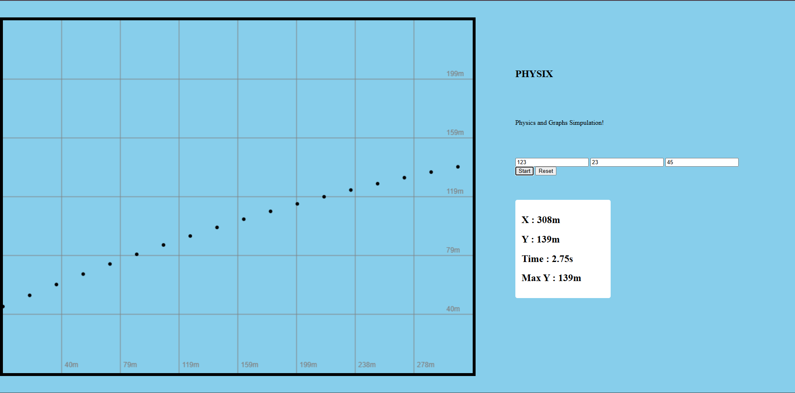

# Physics-and-Graphs
ofc Physics on graphysss test em ! 
 

# PHYSIX 
~ Try [PHSYIX](https://yousufprojs-exe.github.io/PHYSIX/)
PHYSIX is a simple physics simulator that brings projectile motion to life by plotting an object's trajectory on a live graph. Enter the initial speed, launch angle, and starting height to watch how the object moves, track its X and Y positions, measure elapsed time, and see its maximum height — all while visualizing the physics behind its motion 

## Features
- Simulates projectile motion using speed, launch angle, and starting height
- Displays the object's X and Y positions
- Shows elapsed time and maximum height
- Draws the trajectory on a coordinate grid
- Start and reset controls
- Input validation for invalid values

## How to Run
1. Clone or download this repository.
2. Open index.html in your browser.
3. Enter the speed, angle (0–90°), and starting height.
4. Click Start to run the simulation.
5. Click Reset to start again.

" You can also open physix.html directly."

## Built With
- HTML
- CSS
- JavaScript
- HTML Canvas

## Why I Made This
I wanted to make a simple way to see projectile motion on a graph instead of only working with physics equations on paper.
